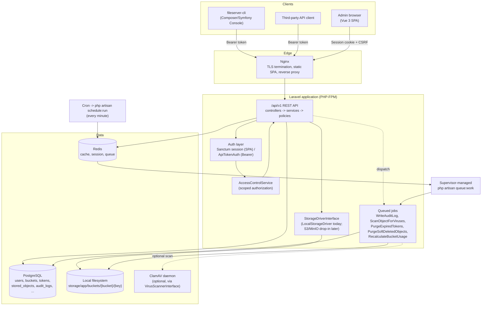
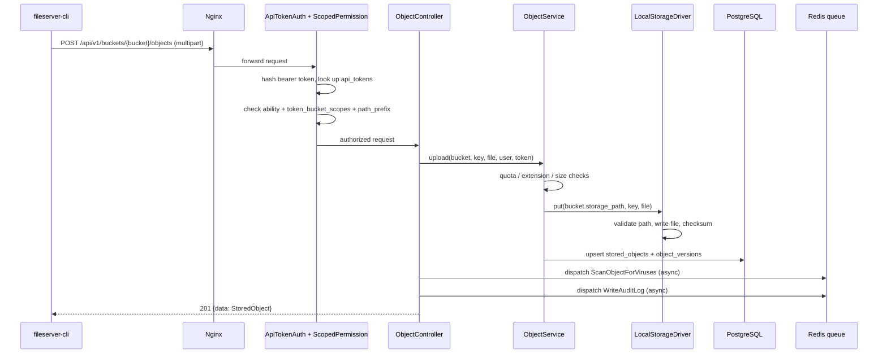

# Architecture

## System overview

## Request flow: authenticated object upload

## Layering

- **Controllers** (`app/Http/Controllers`) — HTTP concerns only: validate via FormRequests, call a service, shape the response via `ApiResponse`/API Resources.
- **Services** (`app/Services`) — business logic: `BucketService`, `ObjectService`, `TokenService`, `UserService`, `QuotaService`, `PresignedUrlService`, `AuditLogService`.
- **Storage abstraction** (`app/Services/Storage`) — `StorageDriverInterface` with `LocalStorageDriver` today; a future `S3StorageDriver`/`MinioStorageDriver` implements the same 6 methods (`put/get/delete/list/exists/makeDirectory`) and is selected per-bucket via `StorageManager`, with zero API/CLI changes required.
- **Authorization** (`app/Services/Authorization/AccessControlService`) — single source of truth for "can this actor do X on bucket/key", consumed by both the `ScopedPermission` route middleware (bucket/object routes) and Policies (`BucketPolicy`, `ObjectPolicy`, `ApiTokenPolicy`).
- **Jobs** (`app/Jobs`) — everything that shouldn't block a request: audit log writes, virus scanning, and scheduled cleanup/recalculation.

See [`ERD.md`](./ERD.md) for the database schema and [`DEPLOYMENT.md`](./DEPLOYMENT.md) for how these pieces map onto real infrastructure.
