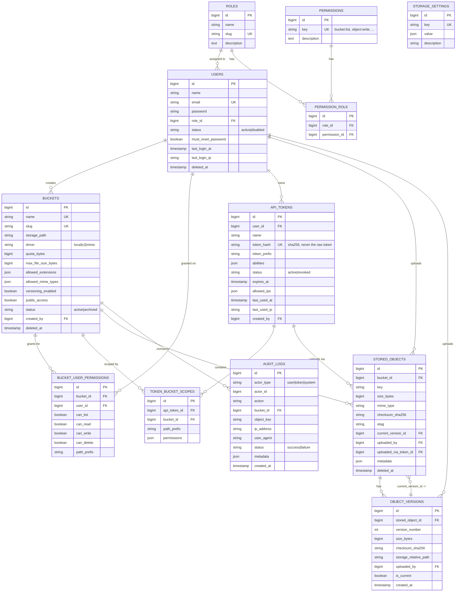

# Database ERD

## Notes

- **`stored_objects(bucket_id, key)`** has a *partial* unique index (`WHERE deleted_at IS NULL`) — only one live object may occupy a key at a time, but a soft-deleted key can be re-uploaded immediately (mirrors S3 semantics). See migration `2026_09_22_000009_create_stored_objects_table`.
- **`api_tokens.token_hash`** is a SHA-256 hash; the raw token is never persisted and is only ever shown once, at creation or rotation time.
- **`audit_logs`** has no foreign key to `users`/`api_tokens` on `actor_id` — `actor_type` + `actor_id` is a lightweight polymorphic pair, since the actor may be a user, a token, or `system` (background jobs).
- Indexes explicitly added per the spec: `buckets.name`, `stored_objects(bucket_id, key)`, `api_tokens.token_hash`, `users.email`, and `audit_logs(created_at, actor_type+actor_id, bucket_id, action, status)`.
